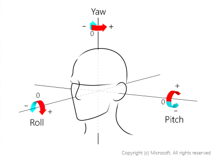

Welcome to the official documentation for **ID Vision**, a facial detection and recognition system.

---

## 📘 Overview

This repository contains all documentation related to camera setup, installation, and system configuration for the ID Vision project.

---

## 📂 Documents

| Document                                      | Description                                                  |
| --------------------------------------------- | ------------------------------------------------------------ |
| [System Requirements](system_requirements.md) | Hardware and software prerequisites for installation.        |
| [Installation Guide](installation-guide.md)   | Step-by-step setup for the ID Vision system.                 |
| [Camera Setup](camera-setup.md)               | Detailed guide for configuring cameras and bitrate settings. |

---

## 🧠 About the Project

The ID Vision project is a private system focused on intelligent video analysis and facial recognition.

---

## 👤 Developer

[Qasem Taheri](https://github.com/Qasemt) — Developer of the ID Vision project.

© 2025 Qasem Taheri – All Rights Reserved.
