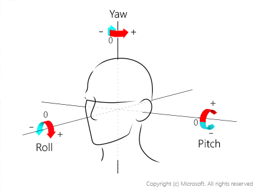

# 🎯 Face Tuning Tool Guide

How to use the **ID Vision Worker**'s Face Tuning page (`/tools/face_tuning`) to test and adjust face-detection thresholds for a specific camera, for the install team.

---

## Overview

The **Face Tuning** page is a diagnostic tool: it runs face detection on a photo or a live camera burst using the thresholds a camera would actually use, and shows every detected face with a pass/fail breakdown per check — so you can see exactly why a face was accepted or rejected, without reading logs or writing code.

It edits the same quality-gate settings as `/config/face_recognition` (see the **Configuring Face Recognition** section of the [ID Vision Worker Service Setup Guide](id_vision_worker_service_setup_guide.md)), but scoped to **one camera at a time**, with a live report instead of typed-in numbers.

---

## How to Use It

1. Open `/tools/face_tuning` in the worker's admin UI.
2. Either:
   - **Upload a photo** (`.jpg`, `.jpeg`, `.png`, up to 10 MB), or
   - **Select a camera** — the tool grabs a short burst of live frames over RTSP.
3. Review the **Detected Faces** table: each face shows its measured Yaw, Pitch, Eye Ratio, Detection Score, Face Area, and Blur, each in green (pass) or red (fail), plus an overall ✅ **Would capture** / ❌ **Would reject** verdict.
4. If several faces were captured, check the **Range Across Captured Frames** panel above the table — it shows the worst (min) and best (max) value seen for each metric, and a **Suggested** value computed from whichever face rows you leave checked, padded by the **Safety margin** percentage (10% by default) so the suggestion isn't set exactly at the edge of what was observed. Uncheck any row that isn't really this person, or looks like a misdetection, before trusting the suggestion.
5. Enter the values you want (typed by hand, or copied from **Suggested**) in the **Save Thresholds** panel and click **💾 Save to Camera**. Leave a field blank to leave it unchanged. This applies immediately to the live pipeline for that one camera — no restart needed.

**Note:** this only sets the **per-camera override** for the one camera selected. Site-wide defaults for every other camera are still set on `/config/face_recognition`.

With **Camera Provider** set to `local`, saving writes into the camera's row in the worker's `config.yaml`. With **Camera Provider** set to `hub`, saving instead writes to that camera's record on the hub's **Camera Pool** page and applies immediately on this worker — and because it's stored on the hub, the tuning is not lost if the camera is later reassigned to a different worker. See the **Managing the Camera Pool** section of the [ID Vision Hub Service Setup Guide](../hub/id_vision_hub_service_setup_guide.md) for the hub side of this.

---

## What Each Value Means

**Yaw** is the left/right turn (facing away from the camera to one side). **Pitch** is the up/down tilt (nodding). **Roll** is a sideways head tilt toward one shoulder — it is measured but ID Vision never checks it, so there is no "Max Roll" setting anywhere in the app.

Plain-language explanation for the install team, with the range of values the software will accept:

| Parameter | Plain-language meaning | Min | Max | Normal default |
| --- | --- | ---: | ---: | ---: |
| **Max Yaw** (`rejection_threshold_yaw`) | How far the head may turn left/right and still count as a usable face. 0° = looking straight at the camera; a higher value accepts more turned/profile faces. | 0° | 90° *(the underlying pose model reports yaw as −90°…+90°, so a face's turn can never measure past this)* | 32° |
| **Max Pitch** (`rejection_threshold_pitch`) | How far the head may tilt up/down and still count as usable. Only enforced while **Enable Pitch Check** is on. | 0° | 90° *(same −90°…+90° range as yaw, from the pose model)* | 15° |
| **Min Eye Ratio** (`min_eye_ratio`) | How clearly both eyes must show, relative to face width — **not** about blinking. Lower values accept faces turned further to the side. | 0 | 1 | 0.32 |
| **Min Detection Score** (`min_det_score`) | The detector's own confidence (0–1) that it really found a face, not hair, an ear, or a shadow. | 0 | 1 | 0.5 |
| **Min Face Area** (`min_face_area_ratio`) | Smallest face size allowed, as a fraction of the whole frame. Rejects faces too small/far away to identify reliably. | 0 | 1 | 0.01 (1% of frame) |
| **Max Face Area** (`max_face_area_ratio`) | Largest face size allowed, as a fraction of the whole frame. Rejects oversized false detections (e.g. a misdetected shadow or object). | 0 | 1 | 1.0 (no cap) |
| **Min Blur** (`min_blur_variance`) | Minimum sharpness of the face crop (higher = sharper required). Rejects motion-blurred or out-of-focus captures. | 0 | *(no software limit — sharper images can score arbitrarily higher)* | 15.0 |
| **Frame Min Diff** (`frame_min_diff_threshold`) | How much a frame must change from the previous one before the worker even looks at it for faces. Lower = catches slower movement but uses more CPU. | 1 *(anything lower is auto-raised to 1 at startup)* | *(no software limit)* | 5 |
| **Max Captures** (`capture_rate_limit_max_captures`) | How many *new* (never-seen-before) faces this camera may log within the **Window** below — protects against a flood at a crowded entrance. | 1 | *(no software limit)* | 30 |
| **Window (s)** (`capture_rate_limit_window_seconds`) | Length of the rolling time window **Max Captures** applies to, in seconds. | 1 | *(no software limit)* | 60 |

> Setting **Max Yaw** or **Max Pitch** above 90° has no extra effect — the pose model never reports a face's angle past ±90°, so any value from 90° upward accepts every face regardless of angle (effectively the same as turning **Reject Low-Quality Faces** off for that check). Fields still marked *(no software limit)* aren't tied to a model output, so there's no natural ceiling to give — treat a large jump away from the Normal default as a sign to double-check the camera's mounting, lighting, or stream quality, not as a routine tuning step.

### Yaw and pitch: worked examples

The **+**/**−** sign only shows which side the head is turned or tilted toward — the check only looks at the size of the number (its distance from 0°), ignoring the sign. So a face at **+32°** and one at **−32°** are treated exactly the same by **Max Yaw**.

| Yaw | Pitch | What it looks like | Passes Normal defaults (Max Yaw 32°, Max Pitch 15°)? |
| ---: | ---: | --- | --- |
| 0° | 0° | Looking straight at the camera | ✅ Pass |
| +12° | +3° | Slightly turned and slightly tilted | ✅ Pass |
| −28° | −10° | Turned and tilted, close to the limit | ✅ Pass |
| +32° | 0° | Exactly at the Max Yaw limit | ✅ Pass (right at the edge) |
| +38° | 0° | Turned further than Max Yaw allows | ❌ Rejected — Yaw check fails |
| 0° | +20° | Tilted further than Max Pitch allows | ❌ Rejected — Pitch check fails (only while Enable Pitch Check is on) |
| −45° | 0° | Strong profile turn | ❌ Rejected at the 32° default — needs Max Yaw raised and Min Eye Ratio lowered, see below |
| ±90° | 0° | Full profile — the most extreme angle the pose model can report | Still short of the back of the head — see below |

---

## Capturing Profile or Angled Faces

Some cameras cannot get a straight-on shot of every face — for example a camera mounted to the side of a doorway, overhead, or catching people mid-stride. To accept these:

- **Raise Max Yaw** if the report shows genuinely angled faces failing the Yaw check at the 32° default — increase it a little at a time and re-run the report after each change, up to 90° (see the note above — anything past 90° has no further effect).
- **Lower Min Eye Ratio** toward **0.18** so a face with only one eye clearly visible (a partial profile) is not rejected.

**Capturing the back of the head is not possible, with any combination of these settings.** Face detection and recognition both require the eyes, nose, and mouth to be visible to the camera. Even at the pose model's own extreme of ±90° yaw — a full side profile — the face is still turned toward the camera, not away from it; there is no face to measure from the back of someone's head. If a site needs people identified as they walk away, the camera has to be repositioned to catch an angled or profile view on the way in, not a rear view on the way out.

---

## Sample Values

| Scenario | Max Yaw | Max Pitch | Min Eye Ratio |
| --- | ---: | ---: | ---: |
| Strict front-face — camera at head height, direct angle to the face | 8° | 15° | 0.32 |
| **Normal (factory default)** | 32° | 15° | 0.32 |
| Wide-angle / profile capture — ceiling-mounted, angled, or crowded scenes | 32° | 15° | 0.18 |

Other fields (Min Detection Score, Min Face Area, Max Face Area, Min Blur, Frame Min Diff, Max Captures, Window) are not angle-dependent — leave them at the Normal default above unless the report on this page shows a specific camera's real faces failing one of those checks (for example, a lower Min Blur for a low-bitrate/compressed stream, or a lower Min Face Area for a camera positioned far from the door).

---

## Troubleshooting

| Symptom | Likely Cause | Resolution |
| ------- | ------------ | ---------- |
| "Upload a photo or select a camera first." | Neither a file nor a camera was chosen before running the report. | Pick one of the two options, then run the report again. |
| "Invalid file type." | Uploaded file is not `.jpg`, `.jpeg`, or `.png`. | Convert or re-export the photo to one of these formats. |
| "File size exceeds the 10MB limit." | Uploaded photo is too large. | Compress or downscale the photo before uploading. |
| "Could not decode the uploaded image." | File extension matches but the file is corrupted or not really an image. | Re-export the photo and try again. |
| "This camera's link is not an RTSP URL; burst capture only supports RTSP sources." | Selected camera's video source is a local webcam or file path, not `rtsp://`. | Use **Upload a photo** for this camera instead, or point Face Tuning at an RTSP-fed camera. |
| "Could not capture any frames from this camera." | Camera is offline, the RTSP URL is wrong, or the network path to it is down. | Verify the stream with the **📸 Preview** button on `/config/camera`, and check the camera's network connection. |
| "No faces were detected in the captured frame(s)." | No usable face in frame at all — not a threshold problem. | Confirm someone is actually in frame and facing generally toward the camera; check focus/lighting. |
| Every row shows red / ❌ Would reject | Camera's mounting angle, distance, or lighting doesn't match the current thresholds. | Check which column(s) are red, then adjust the matching value per the tables above — start from the **Suggested** value. |
| "No camera selected - nothing to save." | Clicked **Save to Camera** without a camera chosen. | Select a camera first, then save. |
| "No values were entered - nothing to save." | All fields in **Save Thresholds** were left blank. | Fill in at least one field before saving. |
| "Camera pipeline is not running yet - try again shortly." | Hub-mode save attempted before the camera's live pipeline has started on this worker. | Wait for the camera to connect (see `/config/camera`), then retry. |
| "Failed to save tuning to the hub for camera ..." | Hub rejected the update, or this worker doesn't currently hold the camera's hub lock. | Check the worker's application log for the hub's error response; confirm this worker is the one the camera is allocated to. |

---

**Author:** Qasem Taheri
**Last Updated:** September 2026
